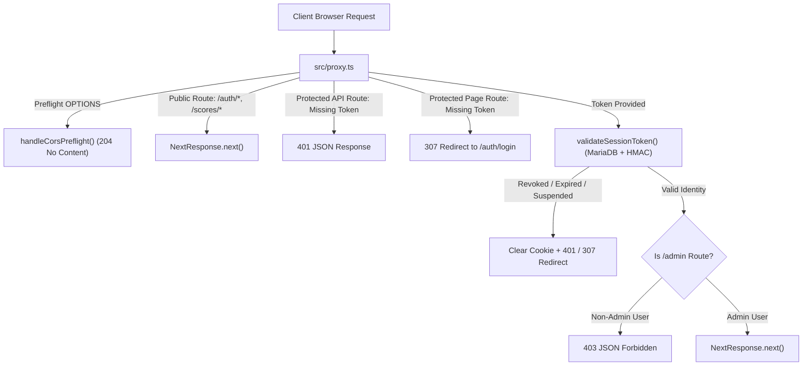

# ROM Vault — Technical Architecture & Emulation Design

> [!IMPORTANT]
> **Notice on Generalized Placeholders**:
> All domains, URLs, and file paths referenced here are generalized for documentation and reference purposes.

---

## 1. System Overview

ROM Vault is a high-performance web-based preservation portal and emulation platform architected with:
- **Frontend**: Next.js 16 App Router, React 19, TypeScript, Tailwind CSS, Lucide icons, Framer Motion.
- **Backend Service**: Node.js service running on port `39254`, reverse-proxied behind Nginx/Apache at `/roms`.
- **Database**: MariaDB connection pool (`src/lib/db.ts`) storing accounts, sessions, user memory cards, high scores, ratings, and cached metadata.
- **Emulation Engines**:
  - **EmulatorJS**: WebAssembly cores executing 8-bit, 16-bit, and 32-bit platforms (NES, SNES, Genesis, Master System, Game Boy, Game Boy Color, Game Boy Advance, N64, and PS1 via `pcsx_rearmed`).
  - **TabStationToo**: PCSX2 WebAssembly port utilizing WebGL 2.0 and WebAudio for PlayStation 2 emulation in-browser.

---

## 2. Request Lifecycle & Routing Layer

Next.js 16 replaces `middleware.ts` with the root proxy convention in `src/proxy.ts`:

---

## 3. High-Performance ROM & Media Streaming

Large media assets (CHD archives, disc images, and gameplay preview MP4s) are streamed directly from the storage pool without loading full files into Node.js heap memory:

- **HTTP 206 Partial Content**: Implemented across `src/app/api/roms/[id]/stream/route.ts` and `src/app/api/media/[category]/[fileName]/route.ts`.
- **Byte-Range Seeking**: Supports `Range: bytes=start-end` requests from HTML5 `<video>` players and WASM emulator disk loaders.
- **Defensive Traversal Guards**: Filenames and path segments are validated against strict character whitelists (`/^[a-zA-Z0-9._-]+$/`) and resolved via canonical path comparisons against `STORAGE_ROOT`.

---

## 4. Concurrency Management: Scanner Mutex

The filesystem rescan routine (`src/lib/scanner.ts`) indexes thousands of ROMs, groups multi-disc titles, and parses game metadata:

- **Atomic Lock Guard**: Controlled via `acquireScanLock()` and `releaseScanLock()`.
- **DoS Mitigation**: Concurrent requests to `/api/admin/scan` while a scan is in progress return `409 Conflict` immediately, eliminating disk I/O starvation and MariaDB connection exhaustion.
- **Admin Role Enforcement**: Protected by server-side `requireAdmin()` session validation.

---

## 5. Virtual Memory Card Architecture

The memory card system synchronizes game progression between browser localStorage, WASM memory buffers, and the cloud:

| Platform | Format | Size | Header / ECC Specification |
| :--- | :--- | :--- | :--- |
| **PlayStation 1** | `.mcr` | Exactly 131,072 bytes (128 KB) | Initialized with `0x00`, 16 frames of 8 KB |
| **PlayStation 2** | `.ps2` | Exactly 8,650,752 bytes (8 MB + ECC) | Initialized with `0xff`, page-spare ECC bytes |
| **Cartridge Systems** | `.srm` | Variable (typically 8 KB – 512 KB) | Battery-backed SRAM raw byte stream |

User memory cards support up to 5 assignable slots per platform with automatic guest fallback downloads for unauthenticated sessions.
